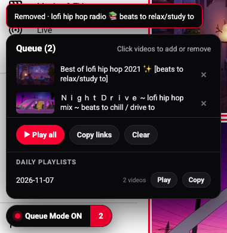

<p align="center"></p>

# YT Click-to-Queue & Auto-Playlist

A Chrome extension for YouTube. Turn on Queue Mode, then click videos in any feed, search, channel page or sidebar to queue them; nothing else on the page changes. Click a video again to take it back out. Each day's picks are saved automatically as a dated playlist (`2026-11-07`), so a cleared queue or closed tab loses nothing.

<p align="center"></p>

## Features

- **One-click queueing.** In Queue Mode, a click on a thumbnail or title adds the video. A second click removes it. Queued cards show a red outline and a `QUEUED #n` badge.
- **Normal browsing still works.** Ctrl/Cmd-click or middle-click opens a new tab as usual. Turn Queue Mode off and clicks behave normally again.
- **Play all.** Plays the whole queue as a YouTube playlist. You don't need an account or an API key.
- **Daily playlists.** Every video you queue is also filed under that day's local date. You can replay or copy any past day.
- **Copy links.** Copies the queue to the clipboard as plain URLs with titles, ready to paste.
- **Shared across tabs.** The queue is the same in every YouTube tab and survives browser restarts.
- **Private.** The only permission is `storage`. Nothing leaves your browser, and the extension has no analytics or remote server.

## Install

### Option 1: Let Your AI Do It

Paste the prompt in [SETUP-PROMPT.md](SETUP-PROMPT.md) into Claude Code, Codex, Cursor, or any assistant that can run commands. It downloads the extension, checks the files, and walks you through the two clicks that Chrome makes you do yourself.

### Option 2: By Hand (About a Minute)

1. Download the code: `git clone https://github.com/MissSophieSterling/yt-click-to-queue.git`, or use **Code → Download ZIP** and unzip it.
2. Open `chrome://extensions` (Edge: `edge://extensions`, Brave: `brave://extensions`).
3. Turn on **Developer mode**.
4. Click **Load unpacked** and choose the `yt-click-to-queue` folder.
5. Open YouTube. The **Queue Mode** pill appears at the bottom left.

## Use

| Action | How |
|---|---|
| Toggle Queue Mode | `Alt+Q`, the toolbar icon, or the pill |
| Queue or remove a video | Click it while Queue Mode is on |
| Open the queue | Click the number on the pill |
| Close the panel | `Esc` or click the number again |
| Play the queue | **▶ Play all** |
| Replay an earlier day | **Daily playlists → Play** |

`Alt+Q` can be changed at `chrome://extensions/shortcuts`.

## How It Works

The extension keeps its own queue in `chrome.storage.local` rather than clicking YouTube's hidden menu buttons, so YouTube layout changes are less likely to break it. **Play all** opens `youtube.com/watch_videos?video_ids=…`, a long-standing YouTube URL that turns a list of IDs into a temporary playlist. YouTube caps that list at 50 videos, so a longer queue plays the first 50.

## Limits

- Desktop youtube.com only (not m.youtube.com or the TV app).
- Play all is capped at 50 videos by YouTube.
- Queue data stays on one browser profile. It does not sync between computers.

## Files

```
manifest.json   Manifest V3, storage permission only
content.js      Click capture, queue panel, page badges
background.js   Toolbar button / Alt+Q toggle and "ON" badge
icons/          icon.svg source plus 16/32/48/128 PNGs
```

## Licence

MIT. Thumbs-up glyph in the icon from Google's Material Icons (Apache-2.0).
